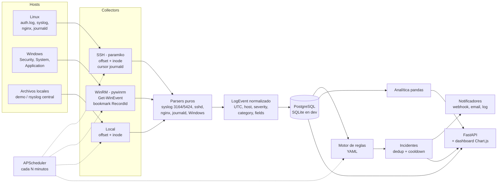

# Centralized Log Analyzer


Analizador de logs centralizado para equipos de soporte L2/L3. Recolecta logs de servidores
Linux (SSH) y Windows (WinRM), los normaliza a un modelo común, los guarda en PostgreSQL y
corre reglas de detección que generan **incidentes deduplicados** (fuerza bruta, crash loops,
bloqueos de cuenta, picos de 5xx, errores repetidos). Incluye API REST, dashboard y CLI.

La idea es cubrir lo que en soporte se hace a mano todos los días: entrar por SSH a varios
servers, hacer `grep` en `auth.log`, abrir el Visor de eventos, comparar timestamps en
distintas zonas horarias y decidir si "esto ya pasó antes".

## Contenido

- [Arquitectura](#arquitectura)
- [Fuentes soportadas](#fuentes-soportadas)
- [Lectura incremental y rotación](#lectura-incremental-y-rotación)
- [Reglas de detección](#reglas-de-detección)
- [Analítica](#analítica)
- [API y dashboard](#api-y-dashboard)
- [Cómo correrlo](#cómo-correrlo)
- [Configuración de hosts reales](#configuración-de-hosts-reales)
- [Tests y CI](#tests-y-ci)
- [Decisiones técnicas y limitaciones](#decisiones-técnicas-y-limitaciones)

## Arquitectura



Flujo de cada ciclo:

1. Cada collector lee **solo lo nuevo** desde la última posición guardada.
2. Las líneas pasan por el parser del formato configurado y se convierten en `LogEvent`.
3. Eventos y nueva posición de lectura se guardan **en la misma transacción**. Si algo falla
   no avanza el offset y el próximo ciclo reintenta.
4. El motor de reglas evalúa una ventana hacia atrás (`LOGAN_DETECTION_LOOKBACK_MINUTES`) y
   genera candidatos. Al persistirlos se deduplican contra incidentes abiertos.
5. Solo los incidentes **nuevos** se notifican.

Estructura del código:

```
src/loganalyzer/
├── models.py          LogEvent, Severity, Category, IncidentCandidate
├── signatures.py      normalización de mensajes (firmas de error)
├── parsers/           funciones puras por formato
├── collectors/        local, ssh, winrm + lógica de offsets/rotación
├── storage/           SQLAlchemy 2.0 (orm, repository)
├── rules/             loader YAML + motor (ventanas deslizantes)
├── notifiers/         webhook, email, log
├── analytics.py       top errores, IPs, errores por hora, firmas nuevas
├── pipeline.py        orquestación collect -> store -> detect -> notify
├── scheduler.py       APScheduler
├── api/               FastAPI + dashboard estático
└── cli.py             typer: collect, analyze, serve, schedule, incidents
```

## Fuentes soportadas

| Formato (`format`) | Origen | Qué se extrae |
|---|---|---|
| `auth` | `/var/log/auth.log` (RFC3164) | sshd: `Failed password`, `Invalid user`, `Accepted`, intentos máximos. Usuario, IP, puerto, método |
| `syslog` | `/var/log/syslog`, RFC3164 y RFC5424 | PRI (facility/severity), structured data, systemd (`Main process exited`, `Scheduled restart job`), kernel (OOM, segfault) |
| `nginx_access` | access log `combined` (+ campos extra como `rt=`) | IP, método, path, status, bytes, user agent, request time |
| `nginx_error` | error log | nivel, upstream, request, client, server |
| `journald_json` | `journalctl -o json` | mismo clasificador que syslog, cursor, unit, prioridad |
| `windows_json` | `Get-WinEvent` serializado por el collector WinRM | 4625, 4624, 4740, 7031/7034, 6008, errores de Application |

Eventos de Windows soportados:

| Canal | Event ID | Categoría |
|---|---|---|
| Security | 4625 logon fallido | `auth_failure` (usuario, IP, tipo de logon, status/substatus) |
| Security | 4624 logon exitoso | `auth_success` |
| Security | 4740 cuenta bloqueada | `account_lockout` (usuario, equipo origen) |
| System | 7034 / 7031 servicio terminó inesperadamente | `service_crash` |
| System | 6008 apagado inesperado | `unexpected_shutdown` |
| Application | Level 1-2 | `application_error` |

Todo termina en el mismo modelo:

```python
class LogEvent(BaseModel):
    timestamp: datetime  # siempre UTC
    host: str
    source: str  # auth, syslog, nginx_access, journald, windows_security...
    severity: Severity  # debug, info, notice, warning, error, critical
    category: str  # auth_failure, service_crash, http_access...
    message: str
    fields: dict[str, Any]  # src_ip, user, service, status...
```

Los campos tienen nombres comunes entre fuentes (`src_ip`, `user`, `service`), por eso una
misma regla de fuerza bruta funciona con `auth.log`, journald o eventos 4625.

**Zonas horarias.** RFC3164 y el error log de nginx no tienen offset. Se interpretan con la
`timezone` del host en el inventario y se convierten a UTC. El año de RFC3164 se infiere
(un log de diciembre leído en enero corresponde al año anterior).

## Lectura incremental y rotación

Para archivos (local y SSH) se guarda `offset` e `inode` por archivo:

| Situación | Cómo se detecta | Qué se hace |
|---|---|---|
| Primera lectura | no hay estado | desde el inicio o desde el final (`initial_position`) |
| Datos nuevos | mismo inode, tamaño mayor | desde el offset guardado |
| Rotación (`logrotate create`) | cambió el inode | se leen las líneas pendientes de `<archivo>.1` si tiene el inode anterior y luego el archivo nuevo desde 0 |
| `copytruncate` | mismo inode, tamaño menor al offset | desde 0 |
| Línea a medio escribir | el bloque no termina en `\n` | queda para el próximo ciclo |
| Archivo ausente | `stat` falla | se conserva el estado y se informa |

Por SSH no se copia el archivo: se usa `stat -L -c '%i %s'` y `tail -c +N | head -c M`,
con rutas escapadas con `shlex.quote`. Para journald se guarda el último `__CURSOR` y se
pide `journalctl -o json --after-cursor=...`. En Windows se guarda el último `RecordId` por
canal y se consulta con `FilterXPath` (`EventRecordID > N`) más `-Oldest`, así el filtro
corre del lado del servidor y se avanza en orden aunque haya más eventos que `MaxEvents`.

## Reglas de detección

Las reglas se definen en [`config/rules.yaml`](config/rules.yaml). Tipos disponibles:

| Tipo | Uso |
|---|---|
| `threshold` | N eventos del filtro dentro de una ventana, por grupo |
| `repeated_signature` | igual, agrupando además por firma de mensaje normalizado |
| `match` | cada evento genera (o actualiza) un incidente |
| `ratio` | threshold + proporción mínima contra un denominador |

Ejemplo, más de 10 logins SSH fallidos desde la misma IP en 5 minutos:

```yaml
- id: ssh_bruteforce
  type: threshold
  title: "Fuerza bruta SSH desde {fields.src_ip} contra {host} ({count} intentos en {window})"
  severity: high
  filter:
    category: auth_failure
  group_by: [host, fields.src_ip]
  window: 5m
  min_count: 11
  cooldown: 60m
```

Pico de 5xx en nginx (al menos 20 errores y 10% de las requests en 5 minutos):

```yaml
- id: nginx_5xx_spike
  type: ratio
  title: "Pico de 5xx en {host}: {count} respuestas 5xx ({ratio} de las requests)"
  severity: high
  filter:
    category: http_access
    field_gte: { status: 500 }
  denominator:
    category: http_access
  group_by: [host]
  window: 5m
  min_count: 20
  min_ratio: 0.10
```

Reglas incluidas: `ssh_bruteforce`, `windows_logon_bruteforce`, `account_lockout`,
`service_crash_loop`, `unexpected_shutdown`, `repeated_error`, `nginx_5xx_spike`.

**Ventanas.** El motor usa una ventana deslizante con dos punteros por grupo. Las ventanas
que se solapan se fusionan en un solo "episodio", así un ataque de 45 intentos genera un
incidente y no 35.

**Deduplicación.** Cada incidente tiene una `dedup_key` (`regla|valores del grupo`). Si llega
actividad nueva para un incidente no resuelto dentro del `cooldown`, se actualiza (`last_seen`,
`count`, `occurrences`) en lugar de crear otro. Re-evaluar la misma ventana es idempotente,
lo que permite que el scheduler mire siempre una hora hacia atrás sin duplicar ni volver a
notificar.

**Firmas de error.** `signatures.normalize_message` reemplaza IPs (v4/v6), UUIDs, hex,
timestamps, emails y números por placeholders:

```
ERROR: duplicate key ... Key (id)=(885123) already exists.
ERROR: duplicate key ... Key (id)=(899001) already exists.
  -> ERROR: duplicate key ... Key (id)=(<N>) already exists.   firma 1341fa4e44d954b8
```

**Notificadores.** Siempre se loguea. Si se configura `LOGAN_WEBHOOK_URL` se hace POST JSON
con un campo `text` compatible con Slack, Teams o Mattermost. Con `LOGAN_SMTP_*` se envía mail.
Un canal caído no frena a los demás. Para agregar uno nuevo alcanza con una clase con
`name` y `send(incident)`.

Qué revisar ante cada incidente:

| Regla | Primeros pasos |
|---|---|
| `ssh_bruteforce` | Confirmar que no hubo `Accepted` posterior desde esa IP, bloquear en firewall/fail2ban, revisar `PasswordAuthentication` |
| `windows_logon_bruteforce` | Ver si son varios usuarios (password spraying), revisar `WorkstationName` y SubStatus `0xC000006A` (password incorrecta) vs `0xC0000064` (usuario inexistente) |
| `account_lockout` | Identificar el equipo origen (caller computer): suelen ser credenciales viejas en un servicio, tarea programada o celular |
| `service_crash_loop` | `journalctl -u <servicio> -n 100` o Visor de eventos, cambios recientes, memoria/OOM, dependencias caídas |
| `nginx_5xx_spike` | error.log de nginx: `connect() failed` = backend caído, `upstream timed out` = backend lento |
| `repeated_error` | Comparar con "firmas nuevas": si apareció después de un deploy suele ser una regresión |

## Analítica

Funciones puras sobre un DataFrame de pandas (`analytics.py`), usadas por la CLI y la API:

- **Top errores** por firma, con plantilla, hosts afectados y rango temporal.
- **Top IPs ofensivas**: fallos de autenticación + respuestas HTTP 4xx/5xx.
- **Errores por host por hora** (tabla pivote con horas vacías completadas en 0).
- **Firmas nuevas**: errores de las últimas 24 h que no aparecieron en los 7 días previos.
  Útil después de un deploy o un cambio de configuración.

Los requests 5xx del access log cuentan en "errores por hora" pero no en los rankings de firmas,
porque su mensaje es solo método + path y ya los cubre la regla de pico de 5xx.

## API y dashboard

`loganalyzer serve` levanta la API en `http://127.0.0.1:8000` (documentación interactiva en `/docs`).

| Método | Ruta | Descripción |
|---|---|---|
| GET | `/api/events` | Búsqueda: `host`, `source`, `category`, `severity`, `min_severity`, `src_ip`, `signature`, `q` (texto), `since`, `until`, `limit`, `offset` |
| GET | `/api/stats/summary?hours=24` | Totales por severidad, categoría y host, incidentes abiertos |
| GET | `/api/stats/errors-per-hour` | Serie por host para gráficos |
| GET | `/api/stats/top-signatures` | Top firmas de error |
| GET | `/api/stats/top-ips` | Top IPs ofensivas |
| GET | `/api/stats/new-signatures` | Firmas nuevas vs línea base |
| GET | `/api/incidents?status=open` | Listado de incidentes |
| POST | `/api/incidents/{id}/ack` | Ack con responsable y nota (`{"by": "soporte-l2", "note": "..."}`) |
| POST | `/api/incidents/{id}/resolve` | Cierra el incidente |
| GET | `/api/meta` | Hosts, fuentes y categorías para filtros |
| GET | `/api/health` | Health check (incluye consulta a la base) |

### Capturas

El dashboard (`/`) es HTML estático con Chart.js desde cdnjs, sin build. Con los datos de la demo muestra:

1. **KPIs** arriba: eventos, errores, auth fallidas, hosts y incidentes abiertos (10 en la demo).
2. **Errores por hora y host**: barras apiladas por host. Se ve el salto de `web-01` en la última
   hora (pico de 5xx + upstream caído) y el de `db-01` por el error de clave duplicada.
3. **Incidentes abiertos**: severidad con color, título, host, cantidad de eventos y botón **Ack**.
4. **Top firmas de error** con la plantilla normalizada (por ejemplo
   `connect() failed (<N>: Connection refused) while connecting to upstream`).
5. **Top IPs ofensivas**: `203.0.113.45` (45 fallos SSH) y `198.51.100.23` (32 logons fallidos en el DC) arriba.
6. **Búsqueda** por host, categoría, severidad mínima y texto.

Salida de `loganalyzer analyze` sobre la demo (resumida):

```
Reglas: 7 | eventos evaluados: 3612 | candidatos: 10 | incidentes nuevos: 10

Incidentes abiertos
 high      nginx_5xx_spike           Pico de 5xx en web-01: 69 respuestas 5xx (33% de las requests)
 medium    repeated_error            Error repetido en web-01 (23 veces en 15m): connect() failed (<N>: ...
 critical  service_crash_loop        Crash loop de Print Spooler en dc-01 (4 caídas en 10m)
 medium    repeated_error            Error repetido en db-01 (35 veces en 15m): ERROR: duplicate key ...
 critical  service_crash_loop        Crash loop de app-worker en web-01 (8 caídas en 10m)
 high      ssh_bruteforce            Fuerza bruta SSH desde 203.0.113.45 contra web-01 (45 intentos en 5m)
 high      windows_logon_bruteforce  Logons fallidos en dc-01 desde 198.51.100.23 (32 en 10m)
 medium    account_lockout           Cuenta bloqueada: mgarcia en dc-01
 medium    account_lockout           Cuenta bloqueada: jperez en dc-01
 high      unexpected_shutdown       Apagado inesperado en dc-01
```

## Cómo correrlo

Requisitos: Python 3.11 o superior. Docker es opcional.

### Demo local (sin servidores)

`scripts/generate_samples.py` genera logs realistas en `samples/` relativos a la hora actual:
tráfico nginx, una fuerza bruta SSH, un crash loop de systemd, un pico de 5xx con upstream
caído, errores de PostgreSQL en RFC5424 con 8 días de línea base, journald y eventos de
Windows (password spraying, bloqueos, Print Spooler cayéndose, apagado inesperado).

Windows (PowerShell):

```powershell
.\scripts\demo.ps1          # crea el venv si hace falta, genera, recolecta y analiza
.\scripts\demo.ps1 -Serve   # además levanta el dashboard
```

Linux / macOS:

```bash
make install
make demo      # generate_samples + collect + analyze (SQLite en data/demo.db)
make serve     # http://127.0.0.1:8000
```

A mano:

```bash
python -m venv .venv && source .venv/bin/activate
pip install -r requirements-dev.txt && pip install -e .
python scripts/generate_samples.py
export LOGAN_DATABASE_URL=sqlite:///data/demo.db
loganalyzer collect --inventory config/hosts.demo.yaml
loganalyzer analyze --since-hours 240
loganalyzer serve
```

Correr `collect` de nuevo no duplica nada (los offsets quedan guardados) y `analyze` de nuevo
no crea incidentes nuevos.

### Docker Compose (laboratorio)

```bash
docker compose up --build
```

Levanta PostgreSQL, la app con el scheduler cada 1 minuto y dos contenedores Debian con
`sshd` + `rsyslog`. Un script dentro de cada uno genera actividad: `linux-01` recibe ráfagas de
logins fallidos y `linux-02` simula un servicio en crash loop. La app los lee por SSH con el
inventario `config/hosts.compose.yaml`. Dashboard en `http://localhost:8000`.

### CLI

```
loganalyzer collect   [--inventory PATH] [--host NAME ...]   recolección incremental
loganalyzer analyze   [--rules PATH] [--since-hours N] [--no-detect]
loganalyzer incidents [--status open|acknowledged|resolved]
loganalyzer serve     [--host 0.0.0.0] [--port 8000] [--scheduler]
loganalyzer schedule                                          recolección + detección periódica
loganalyzer init-db
```

`collect` devuelve código de salida 2 si algún host falló, útil para cron o monitoreo.

## Configuración de hosts reales

Copiar `config/hosts.example.yaml` a `config/hosts.yaml` y `.env.example` a `.env`. Las
credenciales nunca van en el YAML, solo el nombre de la variable de entorno:

```yaml
- name: web-01
  type: ssh
  address: 10.10.0.11
  timezone: America/Argentina/Buenos_Aires
  sudo: true
  credentials:
    username_env: WEB01_SSH_USER
    key_file_env: WEB01_SSH_KEY
  files:
    - { path: /var/log/auth.log, format: auth }
    - { path: /var/log/nginx/access.log, format: nginx_access }
```

Permisos mínimos recomendados:

- **Linux**: usuario dedicado sin shell interactiva de uso general, agregado al grupo `adm`
  (lectura de `/var/log`) y `systemd-journal` (journald). Así no hace falta `sudo`. Si se
  usa `sudo: true`, se ejecuta `sudo -n` y conviene limitarlo en sudoers a `stat`, `tail` y
  `journalctl`.
- **SSH**: por defecto se rechazan host keys desconocidas (`RejectPolicy`). El host tiene que
  estar en `known_hosts`. `strict_host_keys: false` existe solo para laboratorios.
- **Windows**: cuenta de dominio miembro de **Event Log Readers** y con acceso a WinRM
  (`Remote Management Users`), WinRM sobre HTTPS (5986). No requiere administrador.
- `initial_position: end` en producción para no ingerir meses de historia la primera vez.

Variables de entorno principales (prefijo `LOGAN_`): `DATABASE_URL`, `INVENTORY_PATH`,
`RULES_PATH`, `SCHEDULE_MINUTES`, `DETECTION_LOOKBACK_MINUTES`, `WEBHOOK_URL`, `SMTP_*`.

## Tests y CI

```bash
pytest                      # 184 tests
pytest --cov                # ~95% de cobertura
ruff check . && ruff format --check .
```

Qué cubren:

- **Parsers** con líneas reales de cada formato, incluidos casos borde (RFC5424 con escapes en
  structured data, año en RFC3164 al cambiar de año, IPv6, comillas escapadas en user agent,
  mensajes binarios de journald, `/Date(ms)/` de PowerShell 5.1).
- **Firmas**: normalización y estabilidad de hashes.
- **Offsets**: rotación por inode con recuperación de `.1`, copytruncate, líneas parciales,
  lectura por bloques. También con archivos reales en disco.
- **Reglas**: límites de ventana, episodios, grupos, ratio, dedup, cooldown, idempotencia.
- **Collectors** SSH y WinRM con clientes falsos que imitan `paramiko.SSHClient` y
  `winrm.Session` (sin red).
- **API** con `TestClient` sobre SQLite en memoria.
- **Pipeline end-to-end**: genera los samples, recolecta, detecta y verifica que se disparan
  las 7 reglas y que una segunda corrida no duplica eventos ni notificaciones.

GitHub Actions (`.github/workflows/ci.yml`): lint con ruff, tests en Python 3.11, 3.12 y 3.13
(incluye la demo completa) y build de las imágenes Docker con smoke test del health check.

## Decisiones técnicas y limitaciones

- **Parsers puros.** No tocan disco ni red, reciben una línea y devuelven un `LogEvent` o
  `None`. Así se testean con fixtures de texto y se reutilizan entre collectors.
- **Offset en la misma transacción que los eventos.** Garantiza at-least-once sin duplicar lo
  confirmado. Si el proceso muere entre la lectura y el commit, se relee ese bloque.
- **Clasificación por contenido y no por archivo.** Una línea de sshd se interpreta igual venga
  de `auth.log` o de journald.
- **`Invalid user` no cuenta como fallo de autenticación**, porque sshd después loguea
  `Failed password for invalid user` para el mismo intento. Lo mismo con systemd: se cuenta
  `Main process exited` como crash y no `Failed with result`.
- **SQLite para dev y tests, PostgreSQL en producción.** Los timestamps se guardan en UTC. En
  Postgres `fields` usa JSONB. El esquema se crea con `create_all`; para evolucionarlo en
  producción conviene sumar Alembic.
- **Búsqueda de texto con `ILIKE`.** Alcanza para volúmenes chicos/medianos. Para más volumen
  conviene un índice `pg_trgm` o full text search de Postgres.
- **Detección por lotes, no streaming.** Cada ciclo evalúa una ventana hacia atrás. Un
  `count` largo que cruza varios ciclos se reporta como el máximo visto en una evaluación.
- **Rotación**: se recupera la cola de `<archivo>.1`. Si el archivo rotado ya fue comprimido
  (`.gz`) antes de la siguiente lectura, esas líneas se pierden. Con `delaycompress` (default
  en Debian/Ubuntu) no pasa.
- **Windows**: si se vacía el log de eventos, los `RecordId` se reinician y el bookmark queda
  adelantado. Hay que borrar el estado de ese canal (tabla `collector_state`).
- **Sin autenticación en la API.** Pensado para correr en red interna o detrás de un reverse
  proxy con SSO. Es el siguiente paso natural junto con roles para el ack de incidentes.
- Los collectors SSH y WinRM están cubiertos con clientes simulados. Para validarlos contra
  hosts reales está el laboratorio de Docker Compose (Linux). Para Windows hace falta un host
  con WinRM habilitado.
